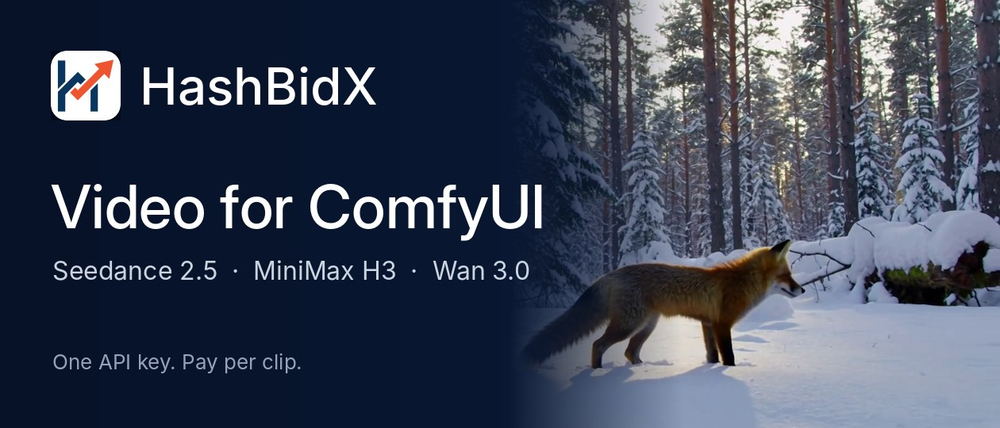

# HashBidX Video for ComfyUI

Use your own HashBidX API key inside ComfyUI to generate video with Seedance 2.5 / 2.0, MiniMax H3 and Wan 3.0: text to video, image to video, first and last frame, references, extending and editing a finished clip. The same key also makes pictures and writes shot lists.
No Comfy credits are used: generation is billed to your HashBidX account.

## Install
- **In ComfyUI:** click the **Extensions** button (top right, next to **Run**) to open the Nodes Manager, search **HashBidX**, click **Install**, then **Apply Changes** to restart ComfyUI. Or run `comfy node install hashbidx-video`.
- **Comfy Desktop:** on the first screen click the **ComfyUI** card (the one on your computer), not **Comfy Cloud**. Plug-ins like this one cannot be installed in Comfy Cloud.
- **Manual:** copy this folder into `ComfyUI/custom_nodes/` and restart ComfyUI.

No extra Python packages are needed.

## Add your key (once)
1. Get a key on the **API Keys** page at https://hashbidx.ai.
2. In ComfyUI open **Templates**, choose **hashbidx-video** at the bottom of the list, and open **1 Save your HashBidX key**.
3. Paste the key into **api_key** (it shows as dots), leave **save_key** on, and press **Run**. Nothing is generated or charged. If you press Run with the field empty, the box simply tells you to paste your key.
4. Clear the key field. The key stays saved on this computer (`ComfyUI/user/hashbidx/config.json`), survives plug-in updates, and never travels inside workflows you share.

A key typed into the **HashBidX API Key** node is never written into the videos and images ComfyUI saves, or into its run history. It is only kept in a workflow file if you save the workflow while the field is filled, so clear the field once the key is saved.

## Quick start
Open **Templates > hashbidx-video** and pick one:

| Template | What it does |
|---|---|
| **1 Save your HashBidX key** | Saves your key on this computer. Run it once. |
| **2 Text to video** | A prompt in, a clip out. |
| **3 Image to video** | Opens with a sample still so it runs right away. Pick your own picture in **Load Image**, describe the motion, press **Run**. |
| **4 Two-shot chain with camera presets** | A timed two-shot prompt with camera presets, then a second clip that continues from the first clip's last frame. |
| **5 First and last frame** | You give the first and the last picture; the model films the motion between them. Opens with two sample stills. |
| **6 Keep a character or product** | A reference picture keeps the same character, product or style in a new scene. Opens with a sample still. |
| **7 Extend a clip** | Makes a clip, then continues it. The result plays as one longer clip. |
| **8 Edit a clip** | Makes a clip, then changes one thing in it and keeps the rest. Shows before and after. |
| **9 Idea to shots to video** | Type an idea; a text model writes the shot list and the video model films it. |
| **10 Picture first, then video** | Makes the opening picture from a prompt, then films it. |

The finished clip plays in the **Save Video** node and is saved to `ComfyUI/output/hashbidx/`. The same files are in this plug-in's `example_workflows` folder if you prefer to drag them onto the canvas.

## Nodes
| Node | What it does |
|---|---|
| **HashBidX API Key** | Holds your key. Save it once, then leave the field empty. |
| **HashBidX Video (Seedance / H3 / Wan)** | Generates the clip: text-to-video, image-to-video, first + last frame, or references. Outputs the video and its **last frame**. |
| **HashBidX Camera & Lens** | Dropdowns for shot size, camera move (and a second move that follows it), lens look, depth of field, lighting, genre, era look, colour grade and pacing. Connect `camera` to the Video node. |
| **HashBidX Multi-Shot Prompt** | Write up to 4 shots with seconds each; it builds one timed prompt for cuts inside a single clip. Connect `prompt` to the Video node's prompt and use `total_seconds` as the duration. |
| **HashBidX Reference Pack** | A folder of character / product images (plus optional reference video and audio links) for consistent subjects. Connect `references` to the Video node. Its `legend` output lists which picture is Image 1, Image 2 and so on, the names to use in the prompt. |
| **HashBidX Extend / Edit Clip** | **Extend** continues a finished clip; **edit** changes something in it and keeps the rest. Connect the `task_id` of a HashBidX Video node to `source_task_id`, or paste a public https link to any clip. Works with every video model. |
| **HashBidX Image** | Makes pictures from a prompt (a first frame, storyboard frames, a character sheet). With a `reference_image` connected it changes or restyles that picture. |
| **HashBidX Shot Writer (idea to shots)** | Turns a short idea into a timed shot list, or into one detailed prompt, with a HashBidX text model. Connect `prompt` and `total_seconds` to the Video node. |

## Use
On **HashBidX Video**:
- `model`, `prompt`, `duration` (seconds, 0 = model default), `resolution` ("default" = model default), `ratio` ("auto" follows the first-frame image, otherwise 16:9)
- `audio`: on / off / model default
- optional `first_frame` (image-to-video), `first_frame` + `last_frame`, or references (`reference_images` batch and/or a **Reference Pack**). References can't be combined with first/last frames.
- `last_frame` output: connect it to the next Video node's `first_frame` to continue a scene shot by shot.
- `extra_params_json` for advanced fields, merged into the request (e.g. `{"metadata": {"watermark": true}}`)

On **HashBidX Extend / Edit Clip**:
- `mode`: **extend** (the prompt says what happens next) or **edit** (the prompt says what to change)
- the source clip: connect `task_id` from the node that made it, or put a public https link into `source_video_url`. A clip that only exists on your computer needs a link first.
- `duration`: seconds of the new part. For an edit, use the length of the source clip.
- `join_with_source` (extend): the `video` output is the source and the new part as one clip; `new_part` is the new part alone.
- a link to a finished clip stays valid for about a day, so extend or edit a clip soon after making it.
- every video model can extend and edit. Seedance and MiniMax H3 read the source clip and film what comes next; on Wan the new part starts on the last frame of the source clip (this happens by itself when you pick a Wan model).

For several versions of the same shot, raise the number next to **Run**: each run makes a new take.

The camera presets are added to your prompt as plain cinematography directions (these models have no separate camera settings), so you can also just write them yourself.

After you pick a model, the `resolution`, `duration` and `audio` settings only offer what that model has (for example 768p / 2k on MiniMax H3, 4k only on Seedance 2.0). If a setting still doesn't fit, for example in a canvas run through the API, the box says what that model offers and nothing is charged.

The Video node submits the job, shows progress, downloads the MP4 to `ComfyUI/output/hashbidx/`, and outputs a standard `VIDEO` you can connect to **Save Video**, upscalers, colour (LUT) nodes or **Get Video Components**.

## What you pay
- You pay only for what is generated (video, pictures, and the text model in Shot Writer), at the prices on https://hashbidx.ai. The plug-in is free and adds no fee.
- The Camera, Multi-Shot and Reference Pack nodes run on your computer and cost nothing.
- **Extend** and **edit** send the source clip to the model as a reference video, so on Seedance they are charged for the new clip plus the seconds of the source clip. An extension on a Wan model starts from the last frame instead and is charged like a normal clip.
- Longer prompts, camera presets, reference images and first/last frames do not change the price.
- Seedance is priced by video size (resolution x seconds); MiniMax H3 and Wan by seconds of output.
- A **reference video** is counted by Seedance as extra input, so that clip costs more (it is billed at the lower "with video input" rate).
- Failed generations are not charged. Your usage page on hashbidx.ai shows the exact charge of every clip.

Typical limits (the API is the source of truth):

| Model | ID | Seconds | Resolution |
|---|---|---|---|
| Seedance 2.5 | dreamina-seedance-2-5 | 4-30 | 480p / 720p / 1080p |
| Seedance 2.0 | dreamina-seedance-2-0 | 4-15 | 480p / 720p / 1080p / 4k |
| Seedance 2.0 Fast | dreamina-seedance-2-0-fast | 4-15 | 480p / 720p |
| Seedance 2.0 Mini | dreamina-seedance-2-0-mini | 4-15 | 480p / 720p |
| MiniMax H3 | MiniMax-H3 | 4-15 | 768p / 2k (always with sound) |
| Wan 3.0 | wan3.0-video | 2-30 | 480p / 720p / 1080p |
| Wan 3.0 Prime | wan3.0-video-prime | 2-30 | 480p / 720p / 1080p |

What each model does (tested with real generations, 27 Nov 2026):

| | Seedance 2.5 | Seedance 2.0 | 2.0 Fast | 2.0 Mini | MiniMax H3 | Wan 3.0 | Wan 3.0 Prime |
|---|---|---|---|---|---|---|---|
| Text to video | yes | yes | yes | yes | yes | yes | yes |
| Image to video (first frame) | yes | yes | yes | yes | yes | yes | yes |
| First + last frame | yes | yes | yes | yes | yes | yes | yes |
| Reference pictures | yes | yes | yes | yes | yes | yes | yes |
| Timed multi-shot prompt | yes | yes | yes | yes | yes | yes | yes |
| Sound | on / off | on / off | on / off | on / off | always on | on / off | on / off |
| Extend a clip | yes | yes | yes | yes | yes | yes, from the last frame | yes, from the last frame |
| Edit a clip | yes | yes | yes | yes | yes | yes | yes |

Pictures: `qwen-image-3.0` and `qwen-image-3.0-pro`, in 16:9, 9:16, 1:1, 4:3 and 3:4.

Get a key at https://hashbidx.ai (API Keys page).
